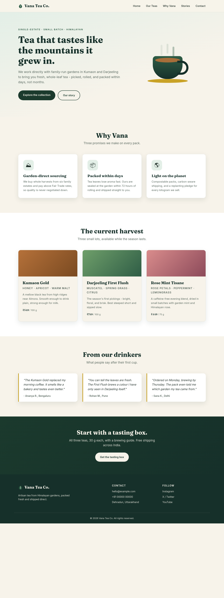
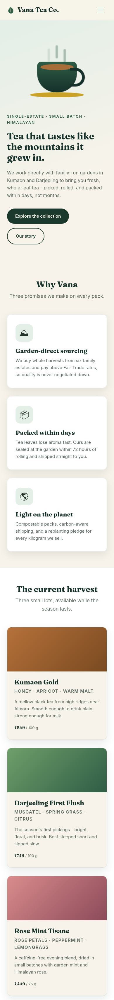

# Vana Tea Co. - Landing Page

**Track:** Web Development and Designing (Oasis Infobyte - OIBSIP)
**Level 1, Task 1:** Landing Page

A responsive marketing landing page for **Vana Tea Co.**, a fictional artisan tea
brand that sources single-estate teas from Himalayan gardens. Built as a static
site with semantic HTML and modern CSS - no JavaScript required.

## Features

- Fixed sticky navigation bar with five links and a pure-CSS hamburger menu on mobile
- Hero section with headline, sub-headline and two call-to-action buttons
- Pure-CSS animated tea cup illustration (no image assets)
- "Why Vana" feature section with three benefit cards
- "The current harvest" product section with three tea cards and pricing
- Testimonial section with three customer quotes
- Call-to-action band and a footer with contact and social links
- Consistent colour palette and typography (Fraunces + Inter) across all sections
- Fully responsive layout (CSS Grid + Flexbox) - no element overlap at any width

## Tech Stack

- HTML5 (semantic elements, accessible labels)
- CSS3 (custom properties, Grid, Flexbox, keyframe animations, media queries)

## How to View

Open `index.html` in any modern browser, or serve the folder:

```bash
python3 -m http.server 8000
# then visit http://localhost:8000
```

## Screenshots

| Desktop | Mobile |
| --- | --- |
|  |  |
