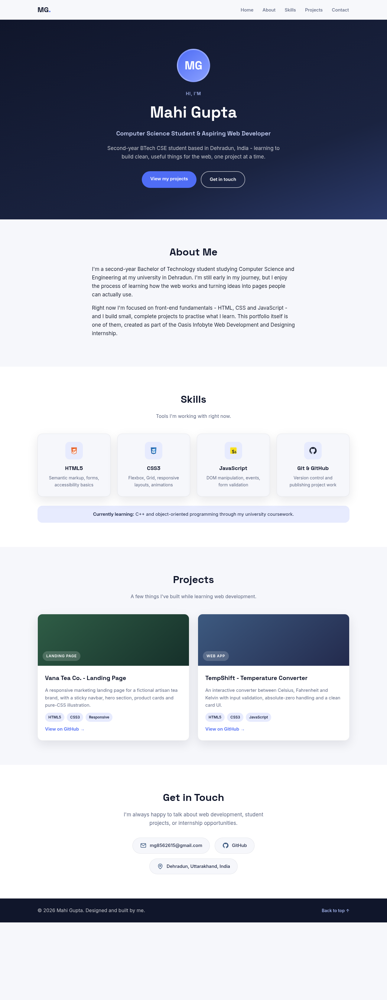
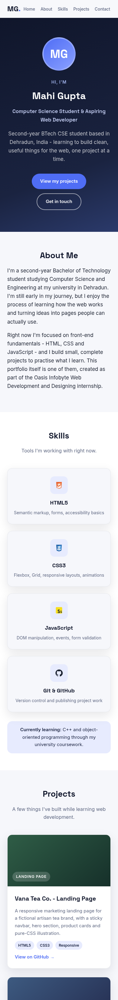

# Mahi Gupta - Personal Portfolio

**Track:** Web Development and Designing (Oasis Infobyte - OIBSIP)
**Level 1, Task 2:** Personal Portfolio

A personal portfolio website for Mahi Gupta - presents her student profile, the
technologies used in the internship projects, the Level 1 task submissions and
how to reach her. Created as Task 2 of the internship.

## Features

- Profile hero section with name, role title and an initials avatar placeholder
- About Me section with an honest introduction
- Technologies section as a visual card grid (HTML5, CSS3, JavaScript,
  Git & GitHub - the stack used in these projects), plus a "currently
  learning" strip for her ongoing university coursework
- Projects section with cards linking to the other internship task submissions
- Contact section with email, GitHub and location cards
- Sticky navbar with smooth-scroll navigation between sections
- Consistent branding (Space Grotesk + Inter, indigo/navy palette) throughout
- Fully responsive - usable on both desktop and mobile

## Tech Stack

- HTML5, CSS3 (JavaScript optional - not required for this build)

## How to View

Open `index.html` in any modern browser, or serve the folder:

```bash
python3 -m http.server 8000
# then visit http://localhost:8000
```

## Screenshots

| Desktop | Mobile |
| --- | --- |
|  |  |

## Demo video

See `demo.mp4` in this folder for a short screen-recorded walkthrough (title card + live demo).
