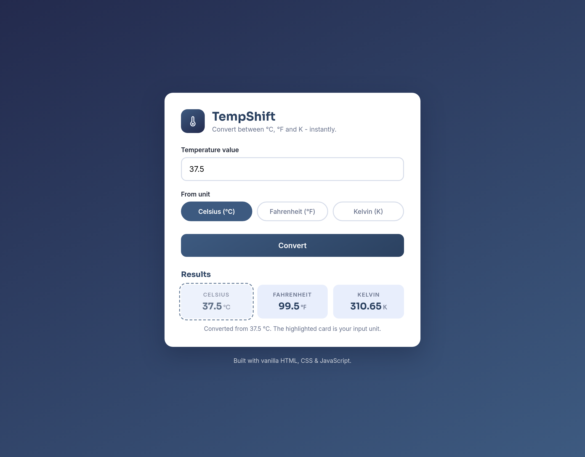
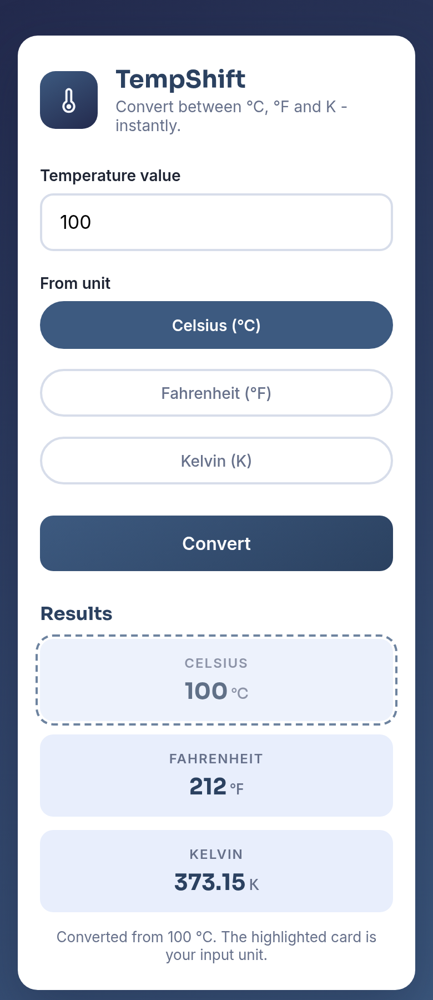
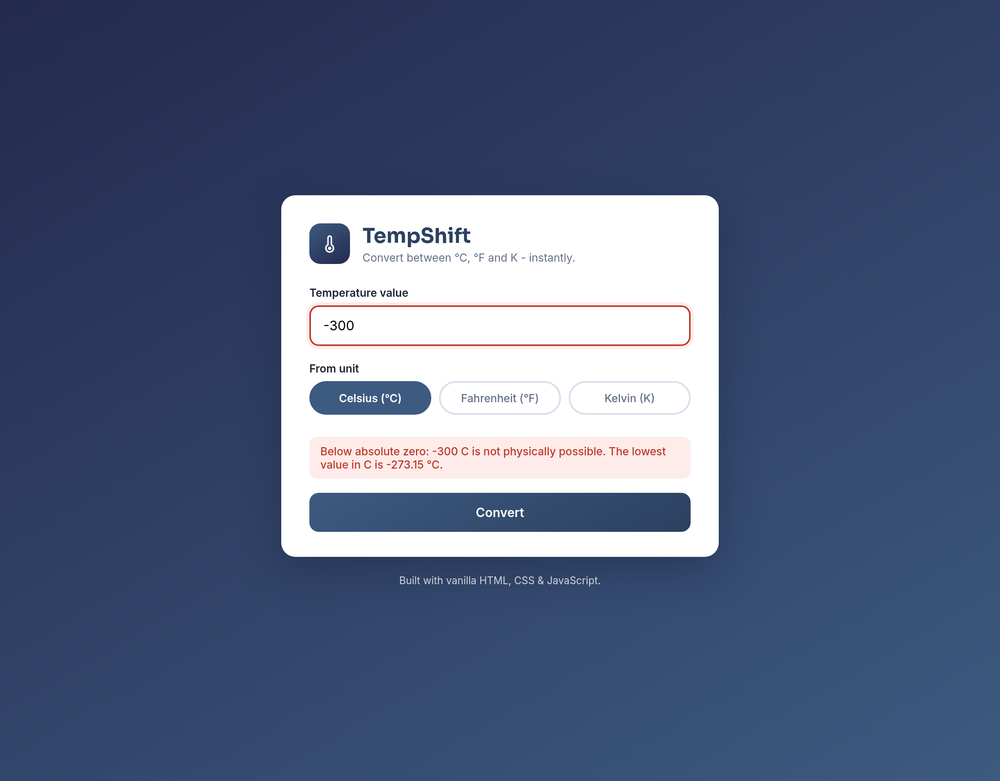

# TempShift - Temperature Converter

**Track:** Web Development and Designing (Oasis Infobyte - OIBSIP)
**Level 1, Task 3:** Temperature Converter Website

An interactive web tool that converts temperatures between Celsius, Fahrenheit
and Kelvin with real-time input validation and absolute-zero edge-case handling.

## Features

- Numeric input with validation - non-numeric input is rejected with a clear error message
- Unit selector (radio pills) for the input unit: Celsius, Fahrenheit or Kelvin
- Convert button that triggers the calculation on click (or Enter)
- All three output units displayed simultaneously; the input unit's card is highlighted
- Absolute-zero handling - physically impossible values (below -273.15 C / -459.67 F / 0 K)
  are rejected with a friendly explanation
- Results rounded to two decimals and formatted for readability
- Errors clear automatically as the user edits the input
- Clean, centred card UI that works on desktop and mobile

## Tech Stack

- HTML5, CSS3, JavaScript (vanilla - no libraries)

## How to View

Open `index.html` in any modern browser, or serve the folder:

```bash
python3 -m http.server 8000
# then visit http://localhost:8000
```

## Conversion Logic

- Fahrenheit = Celsius x 9/5 + 32
- Celsius = (Fahrenheit - 32) x 5/9
- Kelvin = Celsius + 273.15

## Screenshots

| Desktop | Mobile | Validation |
| --- | --- | --- |
|  |  |  |
